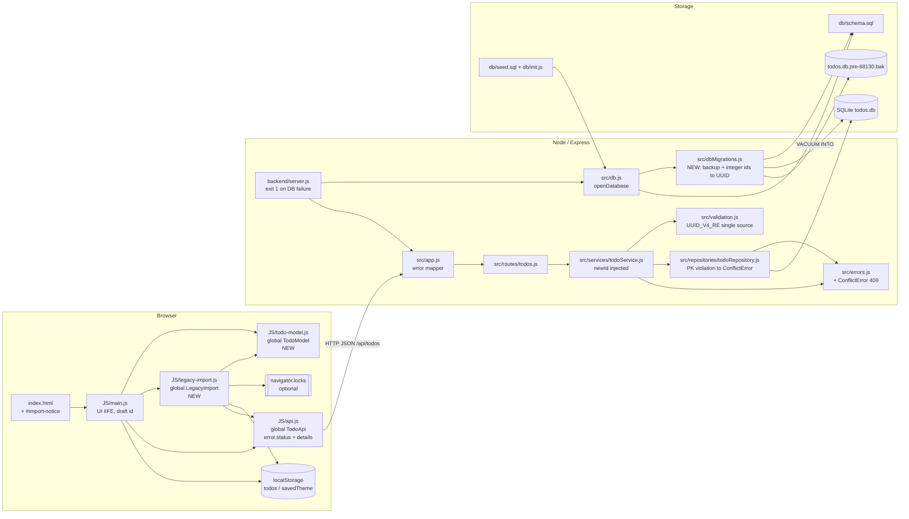
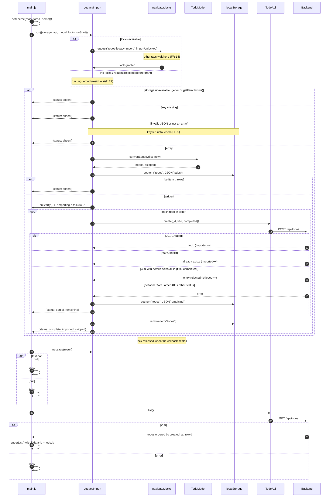
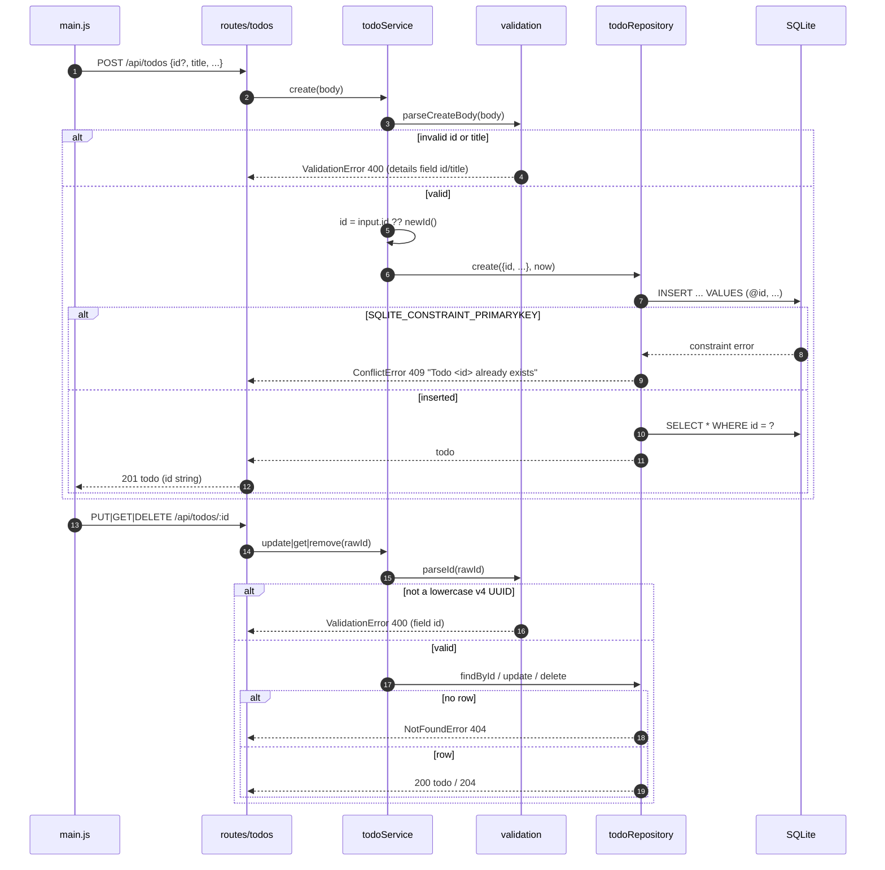
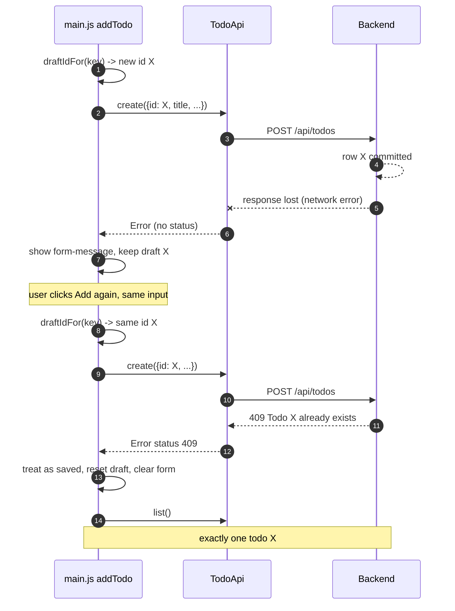

# Architecture — EPMCDMETST-68130: Structured todos with stable IDs

**Input:** [requirements.md](requirements.md) rev 2, [design-review.md](design-review.md), [todo-ids.feature](todo-ids.feature), `.claude/CLAUDE.md`, code on `feature/EPMCDMETST-68130-structured-todos` (base `3a07a9d`)
**Status:** Draft rev 2 — applies design-review AD-1…AD-7 · rev 2.1 (N-1…N-3) **APPROVED** by re-review

## Rev 2 changes

Each change from rev 1 resolves a finding or a decision in `design-review.md`:

| Finding / decision | Change | Sections |
|--------------------|--------|----------|
| D-1 / AD-5 | `api.js` attaches `status` **and** `details`. The import counts a `400` as an invalid entry only when every `details[].field` is in `{title, completed}`. Any other `400` stops the import and keeps the remaining items (EH-4). | §4.2, §4.4, §5.1, §8, §10.1 |
| D-2 / AD-6 | The migration runs in `db.transaction(fn).immediate()` and re-checks `hasIntegerIds` as the first step inside `fn`. A second run returns `0` (tested). | §4.3, §5.3, §10.1 |
| D-3 / AD-4 | The import runs inside `navigator.locks.request('todos-legacy-import', …)` when that API exists, and storage is read inside the lock. `locks` is injected. R7 now covers only browsers without Web Locks. | §2, §3, §4.2, §4.5, §5.1, §11 R7 |
| D-4 / AD-1 | The add form keeps a draft id while title, priority and due date are unchanged. A `409` on create counts as saved. | §4.5, §5.4, §8 |
| D-5 / AD-2 | Jest `coverageThreshold` of 90 % lines is set per logic module, with a new `test:coverage` script that the build scripts run. R3 is closed: `main.js` wiring is covered by the jsdom AC tests (NFR-5 rev 2). | §9, §10, §11 R3 |
| D-6 / AD-3 | Before migrating, the server runs `VACUUM INTO '<db>.pre-68130.bak'`, and never overwrites an existing backup. If the backup fails, nothing is migrated and the process exits 1 (EH-10). `:memory:` is skipped. | §2, §4.3, §5.3, §8, §9, §11 R5 |
| D-7 / AD-7 | An "Importing N task(s) from the previous version…" notice is shown through an `onStart` hook. | §4.2, §4.5, §5.1 |
| D-8 / AD-7 | The fetch mock returns error bodies in the real API shape (`details`), ignores `id` on PUT, and has a parity test. | §10.1 |
| D-9 / AD-7 | The row-count check is removed. | §4.3, §5.3 |
| D-10 / AD-7 | The parity test also compares the regex `flags` and `TITLE_MAX`. Ids are deduplicated **after** lowercasing. Only `SQLITE_CONSTRAINT_PRIMARYKEY` is mapped to `409`. | §4.1, §6.4, §10.1 |
| D-11 / AD-7 | R6 is corrected: `express.static` already revalidates, and the real exposure is tabs left open across the upgrade. | §9, §11 R6 |
| Req rev 2 | FR-13, FR-14, EH-10 and AC-10…AC-12 are added to the traceability table, and the NFR-5 wording is updated. | §10 |

## 1. Context & constraints

The app is a vanilla-JS frontend (`index.html` + plain scripts that share globals, no build step) that talks to an
Express 5 REST API backed by SQLite through better-sqlite3. Today, ids are `INTEGER PRIMARY KEY AUTOINCREMENT`. The
server assigns them, the frontend coerces them with `Number(li.dataset.id)`, `parseId` accepts only positive integers,
and lists use `ORDER BY id ASC`.

The human has already agreed these points (they are not re-opened here):

- Ids are client-generated lowercase v4 UUIDs end to end: `crypto.randomUUID()`, then a `crypto.getRandomValues()` fallback, then a `Math.random()` fallback. SQLite stores them as a `TEXT` primary key.
- The API keeps the field name `title`. `id` is optional on `POST`, and the server generates one when it is absent. A duplicate id returns `409`.
- The legacy `localStorage["todos"]` migration runs in the frontend: convert, write the objects back, POST them one at a time with their ids, treat `409` as already imported, and remove the key when everything is done. On failure the remaining items are kept. A corrupt value that is not an array is left untouched.
- No new dependencies. Jest tests are named after AC ids.
- Design gate (AD-1…AD-4):
  - The add form reuses its draft id.
  - Logic lives in measurable modules with an enforced coverage threshold.
  - The DB is backed up automatically before migrating.
  - Web Locks guard the legacy import.

Constraints that come from the code:

| # | Constraint | Consequence for the design |
|---|------------|----------------------------|
| C1 | `db/schema.sql` runs on every open with `CREATE TABLE IF NOT EXISTS`, so it never alters an existing table. | Existing DBs (for example the Docker volume `/app/data/todos.db`) need an explicit, detected migration (§4.3). |
| C2 | Frontend scripts run in tests through `(0, eval)(source)` in jsdom, and Jest does not instrument eval'd code for coverage. | New frontend logic goes into small dual-export modules (browser global **and** `module.exports`) so unit tests can `require` them and NFR-5 coverage can be measured (§4.1, §4.2). |
| C3 | `seed.sql` inserts 5 rows in one statement, and `strftime('now')` is constant within a statement, so the rows share the same `created_at`. | Ordering needs a tie-breaker (§6.3). |
| C4 | `TodoApi` errors currently carry only `message`. | Migration and the add retry need the HTTP status and the validation `details` to classify failures, so `error.status` and `error.details` are added (§4.4). |
| C5 | `loadTodos()` calls `clearMessage(els.appMessage)` on success. | The import notice cannot reuse `#app-message`, because the next load would clear it. It gets a new element (§4.5). |
| C6 | Node ≥ 20 (`engines`), Jest 30, and jest-environment-jsdom 30 (jsdom 26, which has `crypto.randomUUID`/`getRandomValues` but **no** `navigator.locks`). Node 20 exposes `globalThis.crypto`. | No polyfills are needed in tests. The fallbacks are exercised by injecting or stubbing `crypto`, and Web Locks by injecting a fake `locks`. |
| C7 | `VACUUM INTO` cannot run inside a transaction, and it fails if the target file already exists and is not empty. | The backup runs before the migration transaction and always targets a new file name (§4.3). |

## 2. Technology choices

| Concern | Choice | Why |
|---------|--------|-----|
| Client id generation | `crypto.randomUUID()`, then `crypto.getRandomValues()` with v4 bit-setting, then `Math.random()` | Agreed (FR-2). `randomUUID` exists only in secure contexts, while `getRandomValues` is also available on plain `http://` hosts. |
| Server id generation | `node:crypto` `randomUUID()` | Built in, CSPRNG, lowercase v4. No dependency. |
| Id storage | `id TEXT PRIMARY KEY NOT NULL` on an ordinary rowid table (not `WITHOUT ROWID`) | Agreed (FR-4). `NOT NULL` is required because SQLite allows NULL in non-integer PKs unless it is declared. Keeping the implicit `rowid` gives a cheap insertion-order tie-breaker. |
| Duplicate detection | The SQLite PK constraint. Only `SQLITE_CONSTRAINT_PRIMARYKEY` is caught in the repository. | The database is the single source of truth, there is no check-then-insert window, and it costs one statement (§6.4). |
| Schema migration | Hand-written, detected through `PRAGMA table_info(todos)`, run in one `db.transaction(fn).immediate()` that re-checks inside | One migration does not justify a migration framework (NFR-4). `IMMEDIATE` takes the write lock at `BEGIN`, so two processes cannot both migrate (AD-6). |
| Pre-migration backup | SQLite `VACUUM INTO` (built in) | A consistent, compact copy in one statement with no dependency (AD-3). |
| Cross-tab mutual exclusion | Web Locks API (`navigator.locks`), optional | A platform API, not a dependency. It degrades to unguarded when absent (AD-4). |
| Seed ids | Generated in SQL (`randomblob` expression) inside `seed.sql` | Keeps `seed.sql` self-contained and idempotent, and `init.js` stays unchanged (§6.5). |
| Frontend modules | Plain scripts with one global and a guarded `module.exports` | Follows the CLAUDE.md convention (one global, loaded before `main.js`) and makes the modules `require`-able for coverage (C2). |
| Tests / coverage gate | Jest 30, jsdom, supertest (all existing). `coverageThreshold` is Jest configuration. | NFR-4, NFR-5. |

There are no new runtime or dev dependencies.

## 3. Component diagram



## 4. Components and responsibilities

| Component | Status | Responsibility | Key exports |
|-----------|--------|----------------|-------------|
| `JS/todo-model.js` | **New** | Pure domain model: v4 regex, id generation with fallbacks, id validation, and legacy-entry conversion. No DOM, no storage, no network. | global `TodoModel` = `{ UUID_V4_RE, TITLE_MAX, newId, isValidId, formatV4, fromLegacy, convertLegacy }` |
| `JS/legacy-import.js` | **New** | Runs the one-time legacy import under an optional Web Lock. Storage, API, model and locks are injected. Classifies failures, returns a result object, and builds the notice texts. Owns no DOM. | global `LegacyImport` = `{ KEY, LOCK_NAME, run, isEntryRejection, message, progressMessage }` |
| `JS/api.js` | Changed | Attaches `status` (HTTP status number) and `details` (the array from `error.details`, if any) to thrown errors. Network errors have neither. | `TodoApi` (unchanged surface) |
| `JS/main.js` | Changed | Creates todos with a reusable draft id (AD-1) and treats a `409` on add as saved. Finds todos by string id. Runs `LegacyImport.run` before the first `loadTodos` and renders the progress, result and dismiss states of the import notice. | — (IIFE) |
| `index.html` | Changed | Adds `#import-notice`. Loads `todo-model.js` and `legacy-import.js` before `main.js`. | — |
| `CSS/main.css` | Changed | Adds styles for `.import-notice` and its `[hidden]` state. | — |
| `backend/src/validation.js` | Changed | `UUID_V4_RE` (the single server-side source), `isUuidV4`, `parseId` returns the UUID string, `parseCreateBody` accepts an optional `id`. | `UUID_V4_RE, isUuidV4, TITLE_MAX, parseId, parseCreateBody, parseUpdateBody, parseListQuery, …` |
| `backend/src/errors.js` | Changed | Adds `ConflictError` (409). | `AppError, ValidationError, NotFoundError, ConflictError` |
| `backend/src/services/todoService.js` | Changed | Uses `input.id`, or `newId()` when absent. `newId` is injected (default `crypto.randomUUID`). | `createTodoService({ repository, now, newId })` |
| `backend/src/repositories/todoRepository.js` | Changed | Inserts with an explicit `id`, maps `SQLITE_CONSTRAINT_PRIMARYKEY` to `ConflictError`, and orders by `created_at, rowid`. | `createTodoRepository(db)` |
| `backend/src/dbMigrations.js` | **New** | Detects the legacy INTEGER-id schema, backs up file DBs, and converts the table to TEXT UUID ids in one IMMEDIATE transaction with a re-check inside. | `hasIntegerIds(db)`, `backupPathFor(filename, exists, now)`, `backupDatabase(db, filename, { vacuumInto, exists, now })`, `migrateIntegerIdsToUuid(db, { newId, createSchema })` |
| `backend/src/db.js` | Changed | Opens the DB. If the schema is old, it backs up, migrates, then applies the schema. On failure it closes the DB and throws a clear error. | `openDatabase(filename, { newId, log, vacuumInto })`, `applySchema(db)` |
| `backend/server.js` | Changed | Catches an `openDatabase` failure, logs one clear line, and calls `process.exit(1)`. Logs the backup path and the migrated-row count. | — |
| `db/schema.sql` | Changed | Defines the new `todos` table and indexes, including `idx_todos_created_at`. | — |
| `db/seed.sql` | Changed | Generates a v4 UUID per row in SQL. | — |
| `db/init.js` | Changed (minimal) | Same try/catch and exit-1 handling as `server.js`. | — |
| `package.json` (`jest`, `scripts`), `scripts/build.sh`, `scripts/build.ps1` | Changed (config) | `collectCoverageFrom`, a per-file `coverageThreshold`, the `test:coverage` script, and the build scripts run `test:coverage`. | — |
| `backend/src/routes/todos.js`, `src/app.js`, `src/config.js` | Unchanged | Routes already pass `req.params.id` through. The app's error mapper already handles any `AppError` with `status < 500`, including `details`. | — |
| `README.md` | Changed | API docs: `id` is a UUID string, optional `id` on POST, `409`. Upgrade note about the automatic `.bak` file. | — |

### 4.1 `JS/todo-model.js` (FR-1, FR-2, FR-10a, EH-7, EH-9)

```js
(function (global) {
  const UUID_V4_RE = /^[0-9a-f]{8}-[0-9a-f]{4}-4[0-9a-f]{3}-[89ab][0-9a-f]{3}-[0-9a-f]{12}$/; // mirror of server
  const TITLE_MAX = 200;                                                                       // mirror of server

  function formatV4(bytes)            // 16 bytes -> 'xxxxxxxx-xxxx-4xxx-[89ab]xxx-xxxxxxxxxxxx'
                                      // bytes[6] = (bytes[6] & 0x0f) | 0x40; bytes[8] = (bytes[8] & 0x3f) | 0x80
  function newId(env = { crypto: global.crypto, random: Math.random })
      // 1. env.crypto?.randomUUID is a function -> randomUUID().toLowerCase()
      // 2. env.crypto?.getRandomValues is a function -> try { formatV4(getRandomValues(new Uint8Array(16))) } catch -> step 3
      // 3. formatV4(16 x Math.floor(env.random() * 256))
  function isValidId(value)           // typeof value === 'string' && UUID_V4_RE.test(value)
  function fromLegacy(entry, now)     // -> Todo | null (see table below); a kept id is already lowercased
  function convertLegacy(list, now)   // -> { todos: Todo[], skipped: number }; order preserved;
                                      //    dedupe runs on the lowercased id produced by fromLegacy:
                                      //    a repeated id within the batch is replaced with newId()

  const TodoModel = { UUID_V4_RE, TITLE_MAX, newId, isValidId, formatV4, fromLegacy, convertLegacy };
  global.TodoModel = TodoModel;
  if (typeof module !== 'undefined' && module.exports) module.exports = TodoModel;
})(typeof window !== 'undefined' ? window : globalThis);
```

- `env` is read at call time (it is a default parameter), so tests can inject `{ crypto: undefined }` or a fake
  `getRandomValues`, and a jsdom test can stub `window.crypto.randomUUID`.
- In the browser `module` is undefined, so only the global is set. Under indirect `eval` in jsdom tests `module` is
  also not in scope, so only the global is set there too.

`fromLegacy(entry, now)` rules. The title length is counted in code points (`[...title].length`), the same way as `checkTitle` on the server.

| Entry | Result |
|-------|--------|
| `string` with trimmed length 1–200 | `{ id: newId(), title: trimmed, completed: false, priority: 'medium', dueDate: null, createdAt: now, updatedAt: now }` |
| Plain object (not null, not array) whose `title` (preferred) or `text` is a string with trimmed length 1–200 | Same shape. `id` is `entry.id.toLowerCase()` if that passes `isValidId`, otherwise `newId()`. `completed` is `entry.completed` if boolean, otherwise `false`. `createdAt` is `entry.createdAt` if it is a string, otherwise `now`. |
| Anything else: number, `null`, blank or whitespace string, title over 200 characters, array, object without a usable title | `null` (counted as skipped) |

Objects are accepted because step (b) of FR-10 writes converted objects back. A retry therefore reads objects that
have `title` and a valid `id`, and the ids stay stable. Because `convertLegacy` dedupes on the already-lowercased id
(D-10b), `"ABC…"` and `"abc…"` in one batch become two distinct ids. They cannot `409` against each other and lose an item.

### 4.2 `JS/legacy-import.js` (FR-10, FR-11, FR-14, EH-4, EH-5, EH-6, NFR-6)

```js
LegacyImport.KEY = 'todos';
LegacyImport.LOCK_NAME = 'todos-legacy-import';
const ENTRY_FIELDS = ['title', 'completed'];

async function run({ storage, api, model, locks, now = new Date().toISOString(), onStart = () => {} })
  -> { status: 'absent' }                                     // nothing to do, notice hidden
   | { status: 'complete', imported, skipped }                // key removed
   | { status: 'partial',  imported, skipped, remaining }     // key holds the remaining items
function isEntryRejection(err)  // err.status === 400 && Array.isArray(err.details) && err.details.length > 0
                                //   && err.details.every((d) => d && ENTRY_FIELDS.includes(d.field))
function message(result) -> string | null                     // result text builder (pure)
function progressMessage(count) -> string                     // 'Importing N task(s) from the previous version…'
```

**Locking (AD-4, FR-14).** `run` checks whether `locks` is an object with a `request` function. If it is, `run`
returns `await locks.request(LOCK_NAME, () => importUnlocked(args))`. If `locks` is absent, or `locks.request` throws
or rejects *before* the callback is granted (for example a `SecurityError` in an opaque origin), `run` falls back to
`importUnlocked(args)`. `importUnlocked` never rejects, so a rejection from `request` always means the lock was not
granted. Every storage read happens inside `importUnlocked`, so it runs **inside** the lock. A second tab that waited
for the lock therefore sees either no key (`absent`) or the ids written back by the first tab, which return `409`.

`importUnlocked` (each step that can throw is guarded):

1. `raw = storage.getItem(KEY)`. If this throws, return `absent` (EH-6). If it returns `null`, return `absent`.
2. `JSON.parse(raw)`. If parsing throws, or the value is not an array, return `absent` and leave the key untouched (EH-5).
3. `{ todos, skipped } = model.convertLegacy(parsed, now)`.
4. `storage.setItem(KEY, JSON.stringify(todos))`. If this throws (quota), return `absent` and import nothing, because
   ids that are not persisted would not be stable across retries.
5. If `todos.length > 0`, call `onStart(todos.length)`. Errors from the callback are ignored (D-7).
6. For `i = 0..todos.length-1`, call `await api.create({ id, title, completed })` one at a time (order is preserved, NFR-6):
   - It succeeds: `imported++`.
   - `err.status === 409`: `imported++` (the item was already imported, FR-11).
   - `isEntryRejection(err)`: `skipped++` and continue. The server rejected this entry's own data.
   - Any other error: `remaining = todos.slice(i)`. Then `storage.setItem(KEY, JSON.stringify(remaining))` (errors
     ignored). Return `partial` (EH-4). "Any other error" covers no status (network), 5xx, 404, 413, and any `400`
     whose details are missing or name another field (`id`, `body`). Those point to a systemic client/server
     mismatch rather than a bad entry (D-1, AD-5).
7. `storage.removeItem(KEY)` (errors ignored). Return `complete`.

`message(result)`:

| Result | Text |
|--------|------|
| `absent`, or `complete` with `imported + skipped === 0` (for example `[]`) | `null` (no notice) |
| `complete` | `Imported ${imported} task(s) from the previous version` + (`skipped > 0` ? `; skipped ${skipped} invalid entr(ies)` : '') |
| `partial` | `Could not import ${remaining.length} task(s) from the previous version; will retry next time.` |

`progressMessage(n)` returns `Importing ${n} task(s) from the previous version…`. The literal "(s)" and "(ies)"
follow FR-10e verbatim, so tests can assert exact strings.

### 4.3 `backend/src/dbMigrations.js` + `db.js` (FR-4, FR-5, EH-8, EH-10)

**Detection.** `hasIntegerIds(db)` checks
`db.prepare("PRAGMA table_info('todos')").all().find(c => c.name === 'id')?.type.toUpperCase() === 'INTEGER'`.
A fresh DB has no table, so it returns `false`. A migrated DB has type `TEXT`, so it also returns `false`.

**Backup (AD-3, EH-10).** `backupDatabase(db, filename, { vacuumInto, exists = fs.existsSync, now = () => new Date() })`:

1. Skip and return `null` when `filename === ':memory:'` or `filename === ''` (temporary DB).
2. `target = backupPathFor(filename, exists, now)`. This is `${filename}.pre-68130.bak`, or, if that file already
   exists, `${filename}.pre-68130.${YYYYMMDDTHHMMSSZ}.bak`. An existing backup is never overwritten, and `VACUUM INTO`
   requires a new file (C7). A leftover backup from an earlier failed attempt is therefore kept, and a fresh, current copy is made.
3. `vacuumInto(db, target)`. The default is `db.prepare('VACUUM INTO ?').run(target)`, with the path bound as a
   parameter so no quoting is needed. It runs **outside** any transaction (C7) and reads a consistent snapshot, including WAL content.
4. On error: `fs.rmSync(target, { force: true })` (remove a partial file), then
   `throw new Error(\`Backup to ${target} failed: ${err.message}; database not migrated\`)`.
5. Return `target`.

**Migration (AD-6).** `migrateIntegerIdsToUuid(db, { newId = randomUUID, createSchema })` runs
`db.transaction(fn).immediate()`. `BEGIN IMMEDIATE` takes the write lock up front. A concurrent process waits (5 s
busy timeout) and then re-checks. `fn`:

```sql
-- 0. re-check inside the lock: if NOT hasIntegerIds(db) -> return 0   (another process already migrated)
-- 1. free the global index names (they belong to the old table and would block CREATE INDEX IF NOT EXISTS)
DROP INDEX IF EXISTS idx_todos_completed;
DROP INDEX IF EXISTS idx_todos_priority;
DROP INDEX IF EXISTS idx_todos_created_at;
-- 2. move the old table aside (sqlite_sequence row is renamed with it)
ALTER TABLE todos RENAME TO todos_int_legacy;
-- 3. createSchema(db)  ==  db.exec(schema.sql)  -> new TEXT-id todos + all indexes
-- 4. copy in old id order; each row gets newId() from node:crypto (JS loop over one prepared INSERT)
SELECT id, title, completed, priority, due_date, created_at, updated_at FROM todos_int_legacy ORDER BY id ASC;
INSERT INTO todos (id, title, completed, priority, due_date, created_at, updated_at)
VALUES (@id, @title, @completed, @priority, @due_date, @created_at, @updated_at);
-- 5. drop the old table (also removes its sqlite_sequence row)
DROP TABLE todos_int_legacy;
-- return number of copied rows
```

- Rows are inserted in `id ASC` order, so their new `rowid`s keep the old order. `created_at` and `updated_at` are
  copied unchanged, so FR-6 ordering is preserved (AC-6).
- Rev 1's row-count check is removed (D-9). Every `INSERT` either succeeds or throws inside the transaction, so the
  check could never fail.
- `newId` is injectable so tests can force a failure, for example by returning `'bad'` to violate the id `CHECK` (EH-8).

**`openDatabase(filename, { newId = randomUUID, log = () => {}, vacuumInto } = {})`:**

1. `mkdirSync` (unchanged), then `new Database`, `journal_mode = WAL`, `foreign_keys = ON`.
2. If `hasIntegerIds(db)` (the cheap fast path outside the transaction):
   1. `backup = backupDatabase(db, filename, { vacuumInto })`. If it is not null, run `log(\`Backed up database to ${backup}\`)`.
   2. `n = migrateIntegerIdsToUuid(db, { newId, createSchema: applySchema })`. If `n > 0`, `log(\`Migrated ${n} todo(s) to UUID ids\`)`.
3. `applySchema(db)`. This is a no-op on the migrated or existing new schema, and creates the table on a fresh DB.
4. If any step throws: `db.close()`, then `throw new Error(\`Database setup failed: ${err.message}\`, { cause: err })`.
   A backup failure throws before any migration statement runs. A migration failure is rolled back by better-sqlite3.
   Either way the DB file is unchanged (EH-8, EH-10).

`server.js` wraps `openDatabase(dbPath, { log: console.log })` in try/catch. On error it runs
`console.error(\`[startup] ${err.message}\`)` and `process.exit(1)`. The message names the backup path when the
backup was the cause (EH-10, AC-11). `db/init.js` does the same.

### 4.4 `JS/api.js` change (C4, AD-5)

In `request()`, the `!response.ok` branch changes to:

```js
const error = new Error(message || `Request failed (${response.status})`);
error.status = response.status;
const details = payload && payload.error && payload.error.details;
if (Array.isArray(details)) error.details = details;
throw error;
```

The network branch is unchanged and has no `status` or `details`. Existing callers use only `error.message`, so they are unaffected.

### 4.5 `JS/main.js` changes (FR-8, FR-9, FR-10, FR-12, FR-13, FR-14)

| Location | Change |
|----------|--------|
| `els` | Add `importNotice`, `importNoticeText`, `importNoticeDismiss`. |
| `state` | Add `draft: { id: null, key: null }` (AD-1). |
| new `draftIdFor(key)` | If `state.draft.id === null` or `state.draft.key !== key`, set `state.draft = { id: TodoModel.newId(), key }`. Return `state.draft.id`. `key = JSON.stringify([title, priority, dueDate])` is built from the **trimmed** values that are about to be sent. A changed input therefore produces a fresh id at the next submit, and no input listeners are needed. |
| `addTodo` | Call `const id = draftIdFor(key)`, then `TodoApi.create({ id, title, priority, dueDate })`. On error: if `error.status === 409`, treat it as **saved** (the earlier attempt committed but its response was lost) and continue. Otherwise show `error.message` in `#form-message`, keep the draft id, and return. On success or `409`: `state.draft = { id: null, key: null }`, clear the form, then `loadTodos()` (FR-13, AC-10). |
| `renderTodo` | `li.dataset.id = todo.id` (no `String()` coercion). |
| `findTodo(li)` | `const id = li.dataset.id; return state.todos.find((todo) => todo.id === id);`. No `Number()`. |
| new `storageOrNull()` | `try { return window.localStorage; } catch { return null; }`. If this returns `null`, `runLegacyImport` returns at once (EH-6; some browsers throw on the property getter itself). |
| new `locksOrNull()` | `try { return (navigator.locks && typeof navigator.locks.request === 'function') ? navigator.locks : null; } catch { return null; }` |
| new `async runLegacyImport()` | `const result = await LegacyImport.run({ storage, api: TodoApi, model: TodoModel, locks: locksOrNull(), onStart: (n) => showImportNotice(LegacyImport.progressMessage(n)) });` Then, if `message(result)` returns text, call `showImportNotice(text)`; otherwise hide the notice, because the progress text must not linger. It is wrapped in try/catch as a safety net and never throws. |
| new `showImportNotice(text)` / `hideImportNotice()` / dismiss handler | Sets `importNoticeText.textContent = text` (never `innerHTML`) and `importNotice.hidden = false`. The dismiss button sets `hidden = true`. |
| init | `setTheme(readStoredTheme()); (async () => { await runLegacyImport(); await loadTodos(); })();`. The import runs **before the first list**, so the first render already contains the imported items (AC-3). While it runs, the progress notice explains the empty list (D-7). |

When there is no legacy key, `run` makes **zero** fetch calls and `onStart` is not called. Existing tests that count
calls, such as the search debounce test, therefore stay valid.

`index.html` additions:

- Placed directly after `#app-message`:
  `<div id="import-notice" class="import-notice" data-testid="import-notice" role="status" hidden><span class="import-notice-text" data-testid="import-notice-text"></span><button type="button" class="import-notice-dismiss" data-testid="import-notice-dismiss" aria-label="Dismiss notice">&times;</button></div>`.
  The `<div>`/`</div>` pair keeps the markup balance test green.
- Scripts in this order: `api.js`, `time.js`, `todo-model.js`, `legacy-import.js`, `main.js`.

## 5. Data flow

### 5.1 Page load with legacy import (AC-3, AC-7, AC-8, AC-12, EH-4–6)



### 5.2 Create, update and delete by id (AC-1, AC-2, AC-5)



### 5.3 Server startup: backup and DB migration (AC-6, AC-11, EH-8, EH-10)

```mermaid
sequenceDiagram
  autonumber
  participant SV as server.js
  participant DB as db.js openDatabase
  participant MG as dbMigrations
  participant SQ as SQLite
  participant FS as filesystem

  SV->>DB: openDatabase(dbPath, {log})
  DB->>SQ: open, WAL, foreign_keys
  DB->>MG: hasIntegerIds(db)
  MG->>SQ: PRAGMA table_info('todos')
  alt id type INTEGER
    DB->>MG: backupDatabase(db, dbPath)
    alt file DB
      MG->>FS: exists(<db>.pre-68130.bak)? -> pick new name
      MG->>SQ: VACUUM INTO ?
      alt backup fails
        MG->>FS: rm partial target
        MG-->>DB: Error "Backup to <path> failed; database not migrated"
        DB->>SQ: close()
        DB-->>SV: Error "Database setup failed: ..."
        SV->>SV: console.error, process.exit(1)
      else ok
        DB->>DB: log("Backed up database to <path>")
      end
    else :memory:
      Note over MG: backup skipped
    end
    DB->>MG: migrateIntegerIdsToUuid(db, {newId, createSchema})
    MG->>SQ: BEGIN IMMEDIATE
    MG->>SQ: re-check PRAGMA table_info
    alt already TEXT (another process migrated)
      MG->>SQ: COMMIT (no changes), return 0
    else still INTEGER
      MG->>SQ: DROP INDEX x3, RENAME todos to todos_int_legacy
      MG->>SQ: exec schema.sql (new todos + indexes)
      MG->>SQ: SELECT old rows ORDER BY id; INSERT each with randomUUID()
      alt any error
        SQ-->>MG: throw
        MG->>SQ: ROLLBACK (automatic)
        DB->>SQ: close()
        DB-->>SV: Error "Database setup failed: ..."
        SV->>SV: console.error, process.exit(1)
      else ok
        MG->>SQ: DROP TABLE todos_int_legacy; COMMIT
        DB->>DB: log("Migrated N todo(s) to UUID ids")
      end
    end
  else TEXT or no table
    Note over DB,MG: no-op (idempotent)
  end
  DB->>SQ: exec schema.sql (IF NOT EXISTS)
  DB-->>SV: db
  SV->>SV: createApp({db}).listen(port)
```

### 5.4 Add with lost response and retry (AC-10, FR-13)



## 6. Data model / DTOs

### 6.1 `db/schema.sql` (new)

```sql
CREATE TABLE IF NOT EXISTS todos (
    id         TEXT    PRIMARY KEY NOT NULL
               CHECK (length(id) = 36 AND id = lower(id)),
    title      TEXT    NOT NULL
               CHECK (length(title) BETWEEN 1 AND 200 AND title = trim(title)),
    completed  INTEGER NOT NULL DEFAULT 0
               CHECK (completed IN (0, 1)),
    priority   TEXT    NOT NULL DEFAULT 'medium'
               CHECK (priority IN ('low', 'medium', 'high')),
    due_date   TEXT
               CHECK (due_date IS NULL
                      OR due_date GLOB '[0-9][0-9][0-9][0-9]-[0-9][0-9]-[0-9][0-9]'),
    created_at TEXT    NOT NULL DEFAULT (strftime('%Y-%m-%dT%H:%M:%fZ', 'now')),
    updated_at TEXT    NOT NULL DEFAULT (strftime('%Y-%m-%dT%H:%M:%fZ', 'now'))
);

CREATE INDEX IF NOT EXISTS idx_todos_completed  ON todos (completed);
CREATE INDEX IF NOT EXISTS idx_todos_priority   ON todos (priority);
CREATE INDEX IF NOT EXISTS idx_todos_created_at ON todos (created_at);
```

- The id has **no SQL default**. The application always supplies it, and an INSERT without an id fails on `NOT NULL`,
  which acts as a guard against a silently missing id. The `CHECK` is defense in depth. The strict format check lives in `validation.js` (§6.4).
- `idx_todos_created_at` implicitly contains `rowid`, so `ORDER BY created_at, rowid` is served by the index.

### 6.2 DTOs

| DTO | Shape | Notes |
|-----|-------|-------|
| `Todo` (API response, frontend state) | `{ id: string /*v4*/, title: string, completed: boolean, priority: 'low'\|'medium'\|'high', dueDate: string\|null, createdAt: string, updatedAt: string }` | Only the type of `id` changes. |
| `CreateTodoRequest` | `{ id?: string /*v4 lowercase*/, title: string, completed?: boolean, priority?: …, dueDate?: string\|null }` | `id: null` or a non-string is a `400` (only `undefined` counts as absent). |
| `UpdateTodoRequest` | unchanged (any `id` in the body is ignored, as today) | |
| `ApiError` (thrown by `TodoApi`) | `Error & { status?: number, details?: Array<{ field, message }> }` | `status` and `details` are absent on network errors. |
| `LegacyEntry` (localStorage) | `string \| { id?, text?, title?, completed?, createdAt? }` | Input to `TodoModel.fromLegacy`. |
| `LegacyImportResult` | `{ status: 'absent' } \| { status: 'complete', imported, skipped } \| { status: 'partial', imported, skipped, remaining: Todo[] }` | Output of `LegacyImport.run`. |
| Legacy write-back | `localStorage["todos"] = JSON.stringify(Todo[])` | Only during a migration in progress or after a partial failure. |
| Draft (main.js state) | `{ id: string\|null, key: string\|null }` | `key = JSON.stringify([title, priority, dueDate])` |

### 6.3 Ordering decision (FR-6)

`findAll` uses `SELECT * FROM todos ${where} ORDER BY created_at ASC, rowid ASC`.

- `created_at` is the creation order the requirements specify. It is ISO-8601 UTC with milliseconds and a fixed
  width, so it sorts correctly as text.
- `rowid` breaks ties. Ties are common: the 5 seed rows share one statement timestamp (C3), and fast API calls can
  fall in the same millisecond, as in the "lists all todos in creation order" API test. On a rowid table `rowid` is
  assigned as `max(rowid)+1`, which is insertion order. The migration inserts in old `id` order, so the old order
  carries over.
- An explicit `seq INTEGER` column was rejected: it adds a column and migration work for no user-visible gain. The
  VACUUM caveat is listed under §11.

### 6.4 Validation (server: single source)

```js
const UUID_V4_RE = /^[0-9a-f]{8}-[0-9a-f]{4}-4[0-9a-f]{3}-[89ab][0-9a-f]{3}-[0-9a-f]{12}$/;
const isUuidV4 = (value) => typeof value === 'string' && UUID_V4_RE.test(value);
function parseId(raw) {
  if (!isUuidV4(raw)) throw new ValidationError('Invalid todo id', [{ field: 'id', message: 'must be a lowercase v4 UUID' }]);
  return raw;
}
// parseBody(body, { requireTitle, allowId }) — allowId only for create:
//   if (allowId && body.id !== undefined) isUuidV4(body.id) ? result.id = body.id
//                                                           : errors.push({ field: 'id', message: 'must be a lowercase v4 UUID' })
const parseCreateBody = (body) => parseBody(body, { requireTitle: true, allowId: true });
const parseUpdateBody = (body) => parseBody(body, { requireTitle: false });
```

`UUID_V4_RE`, `isUuidV4` and `TITLE_MAX` are exported. `TodoModel.UUID_V4_RE` and `TodoModel.TITLE_MAX` are necessary
browser copies, because there is no build step to share them. A unit test asserts that `.source` **and** `.flags` of
the two regexes are equal, and that `TodoModel.TITLE_MAX === validation.TITLE_MAX` (D-10a).

**Conflict detection.** `todoRepository.create` runs `insert.run(...)` inside try/catch. Only when
`err.code === 'SQLITE_CONSTRAINT_PRIMARYKEY'` (D-10c) does it throw `new ConflictError(\`Todo ${id} already exists\`)`.
The id has already been validated, so echoing it is safe. Any other error, including a future unique index, is
rethrown and becomes a generic 500 rather than a misleading `409`. There is no `findById` pre-check: the constraint is
atomic, so the repository needs no check-then-insert.

### 6.5 `db/seed.sql`

```sql
-- Inserts sample rows only when the table is empty, so it is safe to re-run.
INSERT INTO todos (id, title, completed, priority, due_date)
SELECT lower(hex(randomblob(4))) || '-' || lower(hex(randomblob(2))) || '-4' ||
       substr(lower(hex(randomblob(2))), 2) || '-' ||
       substr('89ab', 1 + (random() & 3), 1) || substr(lower(hex(randomblob(2))), 2) || '-' ||
       lower(hex(randomblob(6))),
       column1, column2, column3, column4
FROM (VALUES
    ('Read the project plan',      1, 'medium', NULL),
    ('Write the API tests',        0, 'high',   '2030-01-15'),
    ('Review the pull request',    0, 'medium', '2030-01-20'),
    ('Water the plants',           0, 'low',    NULL),
    ('Deploy the app with Docker', 0, 'high',   '2030-02-01')
)
WHERE (SELECT COUNT(*) FROM todos) = 0;
```

- `randomblob` and `random` are evaluated per row. `random() & 3` is used instead of `abs(random()) % 4`, which avoids
  the `abs(INT64_MIN)` overflow. The result is 36 characters of lowercase v4. A test checks every seed id against `UUID_V4_RE`.
- Generating the ids in SQL keeps `seed.sql` self-contained and idempotent, and `init.js` needs no seed logic. This
  is the only place where SQL generates ids. All application paths use `node:crypto`.

## 7. Output / API contract

| Method & path | Change | Success | Errors |
|---------------|--------|---------|--------|
| `GET /api/todos` | Order is `created_at, rowid`, and `id` is a string. | 200 `Todo[]` | 400 query (unchanged) |
| `POST /api/todos` | Optional `id` (lowercase v4). The server generates one if it is absent and stores it unchanged. | 201 `Todo` (`id` = the client id when one was sent) | 400 `{ error: { message: 'Validation failed', details: [{ field: 'id', message: 'must be a lowercase v4 UUID' }] } }`; 409 `{ error: { message: 'Todo <id> already exists' } }` |
| `GET /api/todos/:id` | `:id` is a UUID. | 200 `Todo` | 400 `{ error: { message: 'Invalid todo id', details: [{ field: 'id', … }] } }`; 404 for an unknown valid UUID |
| `PUT /api/todos/:id` | same | 200 `Todo` | 400 / 404 as above. The body `id` is ignored. |
| `DELETE /api/todos/:id` | same | 204 | 400 / 404 |
| `DELETE /api/todos?completed=true` | unchanged | 200 `{ deleted }` | 400 |

Frontend contract: `<li class="todo" data-testid="todo-item" data-id="<uuid>">`, and
`#import-notice[data-testid="import-notice"]` with `import-notice-text` and `import-notice-dismiss`.

Server log lines on upgrade: `Backed up database to <path>` and `Migrated N todo(s) to UUID ids`. On failure, stderr
shows `[startup] Database setup failed: …`.

## 8. Error handling & exit codes

| Failure | Classified as | Outcome |
|---------|---------------|---------|
| POST `id` malformed, upper case, `null` or non-string | `ValidationError` | 400, details `field: 'id'`, nothing stored (EH-1) |
| POST `id` already exists | `SQLITE_CONSTRAINT_PRIMARYKEY` becomes `ConflictError` | 409, existing row unchanged (EH-2) |
| `:id` malformed | `ValidationError` from `parseId` | 400 (EH-3) |
| `:id` valid but unknown | `NotFoundError` | 404 (EH-3) |
| Any other DB or programming error (including other constraint codes) | not an `AppError` | 500 `Internal server error`, logged server side, never echoed (unchanged) |
| Pre-migration backup fails | thrown before the transaction | Partial backup removed, nothing migrated, `Database setup failed: Backup to <path> failed; database not migrated` on stderr, **exit code 1** (EH-10) |
| Startup migration error | thrown inside the IMMEDIATE transaction | Rollback, `db.close()`, `Database setup failed: <reason>` on stderr, **exit code 1** (EH-8). The same applies to `npm run db:init`. |
| A concurrent process already migrated | re-check inside the lock | Returns 0, no changes (FR-4) |
| Startup success | — | Exit code 0 on SIGINT/SIGTERM (unchanged) |
| UI add: `409` | already saved (reused draft id) | Form cleared, list reloaded (FR-13) |
| UI add: any other error | — | `#form-message` shows the message, and the draft id is kept for retry |
| Legacy import: Web Locks absent or request rejected | capability | Runs unguarded (FR-14, R7) |
| Legacy import: storage throws | swallowed | `absent`, app loads (EH-6) |
| Legacy import: invalid JSON or non-array | swallowed | `absent`, key untouched (EH-5) |
| Legacy import: invalid entries (client side) | counted | skipped, reported in the notice (EH-5, EH-9) |
| Legacy import: `409` | already imported | counted as imported (FR-11) |
| Legacy import: `400` with every `details[].field` in `{title, completed}` | entry rejection | skipped and counted, import continues |
| Legacy import: network, 5xx, any other `400`, other status | transient or systemic | Stop, write back the remaining items, show the retry notice, then load the list (EH-4) |
| `crypto.randomUUID` missing, or `getRandomValues` missing or throwing | capability | next fallback generator (EH-7) |

## 9. CI / deployment

- No CI workflow exists in the repo. The new `JS/*.js` files are already covered by `cp -R JS` in the build scripts
  and by the Dockerfile's `COPY JS`.
- **Coverage gate (AD-2).** The `jest` block in `package.json` gets:

  ```json
  "collectCoverageFrom": ["backend/src/**/*.js", "JS/todo-model.js", "JS/legacy-import.js"],
  "coverageThreshold": {
    "./JS/todo-model.js":            { "lines": 90 },
    "./JS/legacy-import.js":         { "lines": 90 },
    "./backend/src/dbMigrations.js": { "lines": 90 },
    "./backend/src/validation.js":   { "lines": 90 }
  }
  ```

  A new script `"test:coverage": "jest --coverage"` is added. `scripts/build.sh` and `scripts/build.ps1` run
  `npm run test:coverage` instead of `npm test`, so the threshold is enforced on every build. `npm test` stays
  without coverage. With `collectCoverage: true`, single-file runs (`-t "AC-1"`, the `test-on-edit` hook) would fail
  the per-file thresholds with "coverage data not found".
- **Docker upgrade path.** The `/app/data` volume keeps the old INTEGER-id DB. On the first start of the new image:
  1. The server writes `/app/data/todos.db.pre-68130.bak`. The volume is already owned by `node`, so the write is permitted.
  2. It migrates in one transaction and logs both steps.
  3. If either step fails, the container exits with code 1 (the restart policy and healthcheck surface it) and the DB file is unchanged.
- **Rollback.** Stop the new image, replace `todos.db` with the `.bak` file (removing any `-wal`/`-shm` files), and
  start the previous release. Document this in the README and CHANGELOG.
- **Browser cache.** `express.static` sends `Cache-Control: public, max-age=0` with ETag and Last-Modified, so a page
  load always revalidates and picks up the new scripts. The only exposure is a tab left open across the upgrade (R6).

## 10. Traceability

| Req ID | Component(s) | Verified by (file :: test name prefix) |
|--------|--------------|----------------------------------------|
| FR-1 | `JS/todo-model.js`, `index.html` script order, `frontend.test.js` `scripts` map | `tests/unit/todo-model.test.js` :: `FR-1` / `AC-1` |
| FR-2 | `TodoModel.newId`, `formatV4` | `todo-model.test.js` :: `AC-4` |
| FR-3 | `validation.parseCreateBody` (`allowId`), `todoService.create` (`newId`), `todoRepository.create` | `tests/api/todos.test.js` :: `AC-5`; `service.test.js`; `frontend.test.js` :: `AC-1` |
| FR-4 | `db/schema.sql`, `todoRepository`, IMMEDIATE + re-check in `dbMigrations` | `repository.test.js` :: `FR-4`; `db-migration.test.js` :: `FR-4` (second migrate returns 0, ids identical) |
| FR-5 | `dbMigrations.js`, `db.openDatabase` | `tests/unit/db-migration.test.js` :: `AC-6` |
| FR-6 | `todoRepository.findAll` ORDER BY, `idx_todos_created_at` | `repository.test.js` :: `FR-6`; `db-migration.test.js` :: `AC-6`; API "creation order" test |
| FR-7 | `validation.parseId`, `todoService` | `todos.test.js` :: `AC-5` |
| FR-8 | `main.js` `renderTodo`, `findTodo` | `frontend.test.js` :: `AC-1`, `AC-2` |
| FR-9 | `main.js`, `todoRepository.delete/update` | `frontend.test.js` :: `AC-2`; `todos.test.js` :: `AC-2` |
| FR-10 | `JS/legacy-import.js`, `TodoModel.convertLegacy/fromLegacy`, `main.js` init + notice | `legacy-import.test.js` :: `AC-3`; `frontend.test.js` :: `AC-3` |
| FR-11 | `LegacyImport.run` 409 branch, `ConflictError` | `legacy-import.test.js` :: `AC-7`; `frontend.test.js` :: `AC-7` |
| FR-12 | `main.js` (unchanged paths), `THEME_KEY` untouched | full regression suite :: `AC-9`; `frontend.test.js` :: `AC-3` asserts `savedTheme` is preserved |
| FR-13 | `main.js` `state.draft`, `draftIdFor`, `addTodo` 409 branch; `api.js` `error.status` | `frontend.test.js` :: `AC-10` |
| FR-14 | `LegacyImport.run` lock wrapper, `main.locksOrNull` | `legacy-import.test.js` :: `AC-12` |
| EH-1 | `validation.parseCreateBody` | `todos.test.js`, `validation.test.js` :: `AC-5` |
| EH-2 | `todoRepository.create`, `errors.ConflictError` | `todos.test.js` :: `AC-5`; `repository.test.js` :: `EH-2` |
| EH-3 | `validation.parseId`, `NotFoundError` | `todos.test.js` :: `AC-5` |
| EH-4 | `LegacyImport.run` stop branch, `isEntryRejection`, `message`; `api.js` `error.details` | `legacy-import.test.js`, `frontend.test.js` :: `AC-7`; `legacy-import.test.js` :: `EH-4` (400 without details or with `field: 'id'` gives partial) |
| EH-5 | `LegacyImport.run` steps 1–2, `fromLegacy` | `legacy-import.test.js`, `frontend.test.js` :: `AC-8` |
| EH-6 | `main.storageOrNull`, `LegacyImport.run` step 1 | `frontend.test.js` :: `EH-6`; `legacy-import.test.js` :: `EH-6` |
| EH-7 | `TodoModel.newId` fallbacks | `todo-model.test.js`, `frontend.test.js` :: `AC-4` |
| EH-8 | `dbMigrations` transaction, `db.openDatabase` close+throw, `server.js`/`init.js` exit 1 | `db-migration.test.js` :: `EH-8` / `AC-6` |
| EH-9 | `TodoModel.fromLegacy` length check (code points) | `todo-model.test.js`, `legacy-import.test.js` :: `AC-8` |
| EH-10 | `dbMigrations.backupDatabase`, `backupPathFor`, `db.openDatabase` | `db-migration.test.js` :: `AC-11` |
| NFR-1 | `UUID_V4_RE` anchored, prepared statements (including the bound `VACUUM INTO ?` path), `encodeURIComponent` in `api.js`, `textContent` for titles and notice | `validation.test.js` :: `NFR-1`; existing XSS test; `frontend.test.js` :: `AC-3` (HTML title from legacy) |
| NFR-2 | `TodoModel.newId`/`formatV4` | `todo-model.test.js` :: `AC-4` (10 000 ids per fallback, all unique and matching) |
| NFR-3 | fallbacks, `storageOrNull`, `locksOrNull`, optional `id` | `AC-4`, `EH-6`, `AC-12` (no-locks case), API test "POST without id still 201" |
| NFR-4 | no `package.json` dependency changes | `npm audit` at verify step |
| NFR-5 | dual-export modules, `collectCoverageFrom` + `coverageThreshold` (≥ 90 % lines on `todo-model.js`, `legacy-import.js`, `dbMigrations.js`, `validation.js`), `main.js` wiring through jsdom AC tests | `npm run test:coverage` (fails below threshold); build scripts |
| NFR-6 | `LegacyImport.run` sequential `await`, progress notice | `legacy-import.test.js` :: `NFR-6` (200 items, order preserved, `onStart(200)` called once) |
| AC-1 | `main.addTodo`, `renderTodo`, service, repo | `frontend.test.js` :: `AC-1`; `todos.test.js` :: `AC-1` |
| AC-2 | `main.findTodo`, `deleteTodo` | `frontend.test.js` :: `AC-2`; `todos.test.js` :: `AC-2` |
| AC-3 | `LegacyImport`, `TodoModel`, `main` init | `frontend.test.js`, `legacy-import.test.js` :: `AC-3` |
| AC-4 | `TodoModel.newId` | `todo-model.test.js`, `frontend.test.js` :: `AC-4` |
| AC-5 | validation, service, repo, errors | `todos.test.js` :: `AC-5`; `validation.test.js`; `service.test.js` |
| AC-6 | `dbMigrations`, `db.js`, ORDER BY | `db-migration.test.js` :: `AC-6` |
| AC-7 | `LegacyImport` partial + 409 | `frontend.test.js`, `legacy-import.test.js` :: `AC-7` |
| AC-8 | `LegacyImport`, `fromLegacy` | `frontend.test.js`, `legacy-import.test.js`, `todo-model.test.js` :: `AC-8` |
| AC-9 | all | every existing suite, updated only for id types (§10.1) |
| AC-10 | `main.draftIdFor`, `addTodo`, `api.js` status | `frontend.test.js` :: `AC-10` |
| AC-11 | `dbMigrations.backupDatabase`, `db.openDatabase`, `server.js` exit 1 | `db-migration.test.js` :: `AC-11` |
| AC-12 | `LegacyImport.run` with `locks` | `legacy-import.test.js` :: `AC-12` |

### 10.1 Test strategy

**Existing tests that change (id type only):**

| File | Change |
|------|--------|
| `tests/unit/frontend.test.js` | See the bullets below this table. |
| `tests/api/todos.test.js` | `expect.any(Number)` becomes `expect.stringMatching(UUID_V4_RE)`. `'/api/todos/9999'` (404 cases) becomes a fixed unknown v4 UUID. The invalid-id list becomes `['abc', '0', '1', '-1', '1.5', '1e3', UPPER_UUID, V1_UUID]`. |
| `tests/unit/repository.test.js` | `repo.create({ ...base, id: ID1, title })`. The `id: 1` expectation becomes `ID1`. `update(99, …)` uses an unknown UUID. `insertRaw` passes an explicit id. The seed test also asserts that every id matches `UUID_V4_RE`. |
| `tests/unit/service.test.js` | The fake repo keys by string id and throws `ConflictError` on a duplicate. The service is created with `newId: () => ID1`. String ids replace `'1'`/`'5'`/`'7'`. A new case: `get('5')` now throws `ValidationError`. |
| `tests/unit/validation.test.js` | `parseId` accepts lowercase v4 and rejects upper case, v1, variant `c`, missing hyphens, braces, a trailing `\n`, `''`, `undefined`, and the number `5`. New: `parseCreateBody` with a valid, invalid or `null` `id`. The update path still ignores `id`. |

Changes to `tests/unit/frontend.test.js`:

- **Scripts.** The `scripts` map gains `model: read('JS/todo-model.js')` and `legacy: read('JS/legacy-import.js')`, and `boot` evals api, time, model, legacy, main.
- **Mock ids.** Seeded ids become `uid(n) = \`00000000-0000-4000-8000-${String(n).padStart(12, '0')}\`` (valid v4).
- **Mock error bodies in the real API shape (D-8).**
  - A non-v4 `body.id` on POST returns `400 { error: { message: 'Validation failed', details: [{ field: 'id', message: 'must be a lowercase v4 UUID' }] } }`.
  - A duplicate id returns `409 { error: { message: \`Todo ${id} already exists\` } }`.
  - Otherwise POST stores `body.id`, or `uid(nextSeq++)` when there is none.
- **Mock id route.** The regex becomes `/^\/api\/todos\/([^/]+)$/` with `decodeURIComponent` and a string compare. A non-UUID returns `400 { error: { message: 'Invalid todo id', details: [{ field: 'id', … }] } }`. An unknown id returns `404 { error: { message: \`Todo ${id} not found\` } }`.
- **Mock PUT.** It drops `body.id` before `Object.assign`.
- **New option `createServer(initial, { failPost })`.** `failPost(body, postIndex)` returns `null` or one of:
  - `'network'`: reject with `TypeError`.
  - `'lost'`: store the todo, **then** reject with `TypeError`. Used by AC-10.
  - a status number, optionally `{ status, details }`.
- **A mock-parity test** asserts that a POST with an upper-case id gives `400` with `details[0].field === 'id'` and that a PUT with `{ id: 'x', completed: true }` keeps the id.
- **Changed assertions.**
  - `'/api/todos/1'` becomes `` `/api/todos/${uid(1)}` `` and `[1]` becomes `[uid(1)]`.
  - The "posts title, priority and due date" body becomes `{ id: expect.stringMatching(V4), title, priority, dueDate }`.
  - "deletes by id, not by text" is renamed to `AC-2: …` and uses "Call mom".

**New tests:**

| File | Contents |
|------|----------|
| `tests/unit/todo-model.test.js` (node env, `require('../../JS/todo-model.js')`) | **`AC-4`:** `newId` with `randomUUID`; with `{ crypto: { getRandomValues } }`; with `{ crypto: undefined }` (Math.random); with a `getRandomValues` that throws. 10 000 ids per path, unique and matching the regex. `formatV4` sets the version and variant bits. **`AC-8`/`EH-9`:** `fromLegacy` for string, object (`text`/`title`, valid, upper-case and invalid id, non-boolean `completed`), number, null, blank, and a 201-code-point title. **`convertLegacy`:** keeps order, counts skipped, re-ids duplicate ids, including an upper/lower-case pair of the same id (D-10b). **Parity:** regex `source` and `flags`, and `TITLE_MAX`, against `backend/src/validation.js` (D-10a). |
| `tests/unit/legacy-import.test.js` (node env, fake storage, api and locks) | See the bullets below this table. |
| `tests/unit/db-migration.test.js` (node env, temp-file DB) | See the bullets below this table. |
| `tests/unit/frontend.test.js` (additions) | **`AC-1`:** POST id equals rendered `data-id` equals stored id. **`AC-2`.** **`AC-3`:** `['A','B']`, POST bodies carry ids, the key is removed, `data-id`s match, the result notice text is shown, the dismiss button hides it, `savedTheme` is preserved. **`AC-4`:** stub `window.crypto.randomUUID = undefined`, and the add still posts a valid id. **`AC-7`:** two boots against the same server with `failPost` on the 2nd POST. **`AC-8`:** three corrupt inputs, boot does not throw and the list renders. **`EH-6`:** `jest.spyOn(Storage.prototype, 'getItem')` throws and the app loads. **`AC-10`:** `failPost` returns `'lost'` on the first POST, so a form message is shown. A second click sends the **same** id, the mock returns `409`, the form is cleared, and exactly one todo is rendered and stored. A changed title after a failure sends a **new** id. |
| `tests/api/todos.test.js` (additions) | **`describe('AC-5 …')`:** 201 with the client id; 201 without an id (the server generates one); 400 for a malformed id on POST (`'abc'`, upper case, `5`, `null`); 409 for a duplicate with the original unchanged; 400 and 404 for GET, PUT and DELETE. **`AC-2`:** rename of the existing duplicate-title delete test. |

`tests/unit/legacy-import.test.js` cases:

- **`AC-3` happy path:** the write-back happens before the first POST with the same ids, POSTs are sequential and in order, `onStart(2)` is called before the first POST, the key is removed, and both messages are exact.
- **`AC-7`:** the 2nd of 3 fails with a network error, so the remaining 2 are written back and the result is `partial` with the retry message. A second run with 409 for already-imported items gives `complete` with no duplicates.
- **`EH-4` (AD-5):**
  - `400` with `details: [{ field: 'title' }]` is skipped and the import continues.
  - `400` with no details gives `partial`.
  - `400` with `details: [{ field: 'id' }]` gives `partial`.
  - `400` with mixed `title` and `body` details gives `partial`.
  - `isEntryRejection` unit cases.
- **`AC-8`:** `"{oops"` and `{}` stay untouched. `[1, null, "", "ok"]` gives imported 1 and skipped 3.
- **`EH-6`:** `getItem` throws.
- **Write-back throws:** the result is `absent` and there is no POST.
- **`[]`:** no notice and no `onStart`.
- **`AC-12` (AD-4):**
  - A fake FIFO `locks.request(name, cb)` and two concurrent `run`s on shared storage holding `["A","B"]` give exactly 2 POSTs. The second run returns `absent`, and the lock name is `todos-legacy-import`.
  - `locks.request` rejecting before the grant still imports (fallback).
  - With no `locks`, the import still runs.
- **`NFR-6`:** 200 items, in order.

`tests/unit/db-migration.test.js` cases (node env, temp-file DB):

- **Fixture:** `tests/fixtures/schema-integer-ids.sql`, a verbatim copy of the current `schema.sql`. It is loaded with rows that have different and **equal** `created_at` values and gaps in the ids.
- **`AC-6`:** after `openDatabase(file)`:
  - The id type is TEXT and every id matches the regex.
  - Every other column is equal, and the order equals the old `id` order.
  - The indexes exist and `todos_int_legacy` is gone.
  - A second `openDatabase` changes nothing (the ids are identical).
- **`FR-4` (AD-6):** `migrateIntegerIdsToUuid` called directly on an already-migrated DB returns `0` and the ids are unchanged.
- **`EH-8`:** `openDatabase(file, { newId: () => 'bad' })` throws `Database setup failed`. On reopen with raw better-sqlite3, the old INTEGER table and its rows are intact.
- **`AC-11`:**
  - After a successful upgrade, `<file>.pre-68130.bak` exists and is readable with better-sqlite3, with INTEGER ids and the original rows.
  - An existing `.bak` is not overwritten, and a timestamped one is created instead (`backupPathFor` with injected `exists` and `now`).
  - `openDatabase(file, { vacuumInto: () => { throw new Error('disk full') } })` throws a message that contains the backup path and `database not migrated`. The DB still has INTEGER ids, and no partial `.bak` is left behind.
  - `:memory:` creates no backup.
- **Fresh DB:** it is not migrated and not backed up.

## 11. Risks & alternatives considered

| # | Risk | Mitigation / status |
|---|------|---------------------|
| R1 | `VACUUM` may renumber `rowid`s on tables without an INTEGER PK. That could change the order of rows **with identical `created_at`**. | The app never runs a plain VACUUM. `VACUUM INTO` writes a separate file and leaves the live DB alone. Only the tie-break is affected. Accepted. |
| R2 | Clock skew. If an old DB has `created_at` values that are not monotonic with `id`, ordering by `created_at` after migration differs from the old `id ASC` order. | Only possible if the server clock went backwards. FR-6 explicitly specifies `created_at` first. Accepted, and the AC-6 test uses monotonic timestamps plus ties. |
| R3 | ~~NFR-5 coverage of `main.js`.~~ | **Closed (AD-2).** NFR-5 rev 2 measures the logic modules with an enforced threshold and covers `main.js` wiring through the jsdom AC tests. |
| R4 | Invalid legacy entries (including titles over 200 characters) are dropped from storage once the import completes. | Per FR-10 and EH-9 they are counted in the notice. Accepted per the requirements. |
| R5 | ~~No downgrade after the DB migration.~~ | **Mitigated (AD-3).** The automatic `.pre-68130.bak` makes a downgrade possible (§9). Residual risks: the backup needs about the DB's size in free disk, and failing that is EH-10 (exit 1, nothing changed). Backups accumulate only if the migration fails repeatedly. |
| R6 | A tab left open across the upgrade still runs the old `main.js`. Its `findTodo` (`Number(...)`) returns `undefined` for UUID ids, so toggle, edit and delete silently do nothing until the tab is reloaded. | A normal load revalidates (`max-age=0` + ETag/Last-Modified), so only already-open tabs are affected. Mentioned in the CHANGELOG. Accepted. (Corrected per D-11.) |
| R7 | Browsers **without** Web Locks (very old browsers, or `request` rejected in opaque origins) run the import unguarded. If two such tabs read the original string array at the same moment, each generates different ids and both imports succeed, so every item is duplicated. | Web Locks are available in all current evergreen browsers, so the window needs an old browser **and** a simultaneous multi-tab restore. Accepted residual risk (AD-4). |
| R8 | The tab closes mid-import. | The key still holds the full written-back list. The next load re-POSTs, already-imported items get `409`, and the import completes. |
| R9 | The `Math.random` fallback is not cryptographically strong. | Ids are identifiers, not secrets. The 409 path makes a collision visible rather than silently overwriting data. Used only when `crypto` is entirely absent. |
| R10 | The regex and `TITLE_MAX` are duplicated in the browser and on the server. | The parity unit test (source, flags, `TITLE_MAX`) fails on drift. |
| R11 | Draft-id reuse (AD-1): a `409` on a **freshly generated** id would be treated as saved even though nothing was saved. | It needs a v4 collision (about 2^-122). Accepted. |
| R12 | A 5 s busy timeout. A second process that waits longer than that for the migration lock fails with `SQLITE_BUSY`, which leads to exit 1. | Migration of realistic DB sizes takes milliseconds. Restarting the process resolves it, and the re-check makes the restart a no-op. Accepted. |

**Alternatives considered**

| Alternative | Decision |
|-------------|----------|
| A SQL `DEFAULT (… randomblob …)` on `todos.id` | Rejected. It would hide missing ids in app code, and it would create two id generators on the hot path. The SQL expression is used only in `seed.sql`. |
| Generate seed ids in `init.js` with `randomUUID` | Rejected. `seed.sql` would no longer be runnable on its own, and the existing idempotency test executes `seed.sql` directly. |
| A pre-check with `findById` before INSERT to detect duplicates | Rejected in favour of the PK constraint (atomic, one statement). |
| A `WITHOUT ROWID` table | Rejected. It loses the free insertion-order tie-breaker. |
| An explicit `seq INTEGER` ordering column, or `seq INTEGER PRIMARY KEY` + `id TEXT UNIQUE` | Rejected. It contradicts the agreed "TEXT primary key", and adds migration and DTO complexity for an edge case (R1). |
| Create `todos_new`, copy, drop, then rename | Rejected in favour of rename-old-first. That keeps `schema.sql` as the only DDL and avoids index-name clashes. |
| A deferred transaction for the migration (rev 1) | Replaced by `.immediate()` plus a re-check inside (D-2). |
| Copy the DB file with `fs.copyFileSync` as a backup | Rejected. It is not consistent under WAL (it misses `-wal` content). `VACUUM INTO` produces a consistent single file. |
| Treat every `400` during the legacy import as an invalid entry (rev 1) | Replaced by field-based classification (D-1). |
| `collectCoverage: true` so that `npm test` always enforces thresholds | Rejected. Per-file thresholds break single-file and `-t` runs, so a separate `test:coverage` script is used and the build runs it. |
| Inline the migration in `main.js` | Rejected. It is untestable for coverage (C2) and mixes I/O with the UI. |
| Reuse `#app-message` for the import notice | Rejected. `loadTodos()` clears it on success (C5), and it is `role="alert"`. The new notice is `role="status"` and dismissible. |
| Rename `title` to `text` | Out of scope (Q5). |

**Requirements not fully met:** none. Every FR (1–14), EH (1–10), NFR (1–6) and AC (1–12) maps to a component and a
named test in §10. The remaining risks R7, R11 and R12 are accepted residual risks, not unmet requirements.

## Rev 2.1 addendum: re-review minor findings

| Finding | Resolution |
|---------|------------|
| N-1 | **Single verified backup.** `backupDatabase` writes `VACUUM INTO '<db>.pre-68130.bak.tmp'`, checks that the copy still has integer ids, then renames it over `<db>.pre-68130.bak`. There are no timestamped backups. A restart loop keeps exactly one backup, and a racing process that sees an already-migrated DB takes no backup. The AC-11 test becomes "replaced by a verified fresh copy". |
| N-2 | Before waiting for the Web Lock, a generic notice "Checking for tasks from the previous version…" is shown. The residual risk that a hung first-tab request delays the second tab is recorded in §11. |
| N-3 | The coverage reasoning is reworded: per-file thresholds fail any partial run, so they are enforced in `npm run test:coverage` and the build scripts. The README documents `npm run test:coverage` as the gate to run before a PR. |