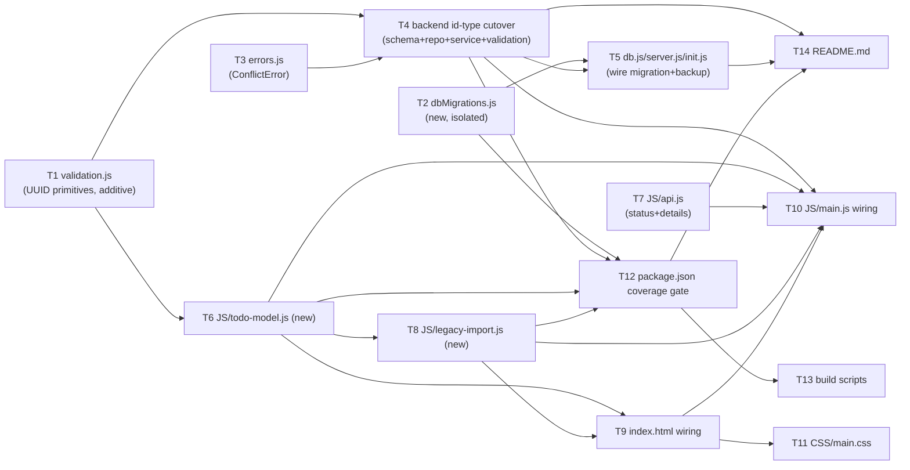

# Implementation Plan — EPMCDMETST-68130

**Branch:** feature/EPMCDMETST-68130-structured-todos | **Tasks:** 14 | **Design:** architecture.md rev 2.1 (APPROVED, re-review) · requirements.md rev 2

**Baseline:** `npm test` is green with 128 tests across `tests/api/todos.test.js`, `tests/unit/{frontend,repository,service,validation}.test.js`.

**Note on task size.** T4 is larger than the usual 1–3 files because the client/server **id-type cutover is a single
indivisible change**: `backend/src/validation.js#parseId` cannot start rejecting integer ids until
`backend/src/repositories/todoRepository.js` stores and returns UUID ids, and neither can land without
`db/schema.sql` already defining `id TEXT PRIMARY KEY`. Any attempt to land these separately leaves `npm test` red
in between (`service.test.js`, `tests/api/todos.test.js` exercise the full `validation → service → repository`
chain). This is exactly the case the "tasks that change the id type must update the affected existing tests in the
same task" rule anticipates. Every other task stays at 1–3 files.

## Dependency graph

**Critical path:** T1 → T6 → T8 → T9 → T10 (5 tasks; gates the full frontend AC regression). The coverage-gate
branch T1 → T6 → T8 → T12 → T13 ties at the same depth and can run in parallel once T8 lands.

## Task list

- [x] **T1 — Shared UUID validation primitives (additive)**  · P0 · Depends on: — · Covers: FR-2, FR-3, FR-7, NFR-1, D-10a (groundwork)
  - **Files:** `backend/src/validation.js`, `tests/unit/validation.test.js`
  - **Skill:** —
  - **Steps:**
    1. Add `const UUID_V4_RE = /^[0-9a-f]{8}-[0-9a-f]{4}-4[0-9a-f]{3}-[89ab][0-9a-f]{3}-[0-9a-f]{12}$/;` and
       `const isUuidV4 = (value) => typeof value === 'string' && UUID_V4_RE.test(value);` (architecture §6.4).
    2. Export both from `module.exports` alongside the existing `TITLE_MAX`. **Do not** change `parseId` or
       `parseCreateBody` yet — that lands in T4 together with the repository/service that consume string ids.
    3. Add a new `describe('isUuidV4')` block: accepts a lowercase v4 string, rejects upper case, v1 (`...-1...`),
       variant `c`, missing hyphens, `''`, `undefined`, a number. Add a smoke assertion that `UUID_V4_RE.source` and
       `.flags` are stable (used later by the T6 parity test).
  - **Verify:** `npx jest tests/unit/validation.test.js`
  - **Done when:** the new `isUuidV4`/`UUID_V4_RE` tests pass and every existing `validation.test.js` case (still
    exercising the unchanged integer `parseId`) is untouched and green.

- [x] **T2 — `backend/src/dbMigrations.js` (new, isolated)**  · P0 · Depends on: — · Covers: FR-4 (re-check), FR-5, EH-8, EH-10, AC-6 (module), AC-11 (module), N-1
  - **Files:** `backend/src/dbMigrations.js`, `tests/fixtures/schema-integer-ids.sql`, `tests/unit/db-migration.test.js`
  - **Skill:** —
  - **Steps:**
    1. Create `tests/fixtures/schema-integer-ids.sql` as a **verbatim copy of today's `db/schema.sql`** (the
       `INTEGER PRIMARY KEY AUTOINCREMENT` version) — this captures the "old" shape before T4 rewrites the real file.
    2. Implement `hasIntegerIds(db)` per architecture §4.3 (`PRAGMA table_info('todos')`, `type.toUpperCase() === 'INTEGER'`).
    3. Implement `backupDatabase(db, filename, { vacuumInto, exists, now })` applying the **N-1 fix**: `VACUUM INTO
       '<filename>.pre-68130.bak.tmp'` (delete any stale `.tmp` first), open the copy read-only, confirm
       `hasIntegerIds` is still true on it, discard and skip the backup if not, then `fs.renameSync` the tmp file
       over `<filename>.pre-68130.bak` (always replacing it — no timestamped backups). Skip entirely for `:memory:`/`''`.
       On `vacuumInto` failure: remove the partial target, throw `Backup to <target> failed: ...; database not migrated`.
    4. Implement `migrateIntegerIdsToUuid(db, { newId = require('node:crypto').randomUUID, createSchema })` as
       `db.transaction(fn).immediate()`, re-checking `hasIntegerIds` as the **first statement inside** `fn` (return
       `0` if already migrated). Steps: drop the 3 named indexes, `RENAME todos TO todos_int_legacy`, call
       `createSchema(db)` (injected — do **not** require `db/schema.sql` to already be the new shape), copy rows in
       `id ASC` order through one prepared `INSERT` with a fresh `newId()` per row, `DROP TABLE todos_int_legacy`,
       return the copied-row count. No row-count assertion (D-9 — removed by design).
    5. `tests/unit/db-migration.test.js`: load the fixture into a temp-file DB (varying/equal `created_at`, id gaps),
       and test `migrateIntegerIdsToUuid` directly with an **injected `createSchema`** (a literal `CREATE TABLE`
       string matching the eventual `id TEXT PRIMARY KEY` shape) so this task does not depend on the real
       `db/schema.sql` yet. Cover: second call on an already-migrated DB returns `0` with ids unchanged (FR-4);
       `newId: () => 'bad'` throws and the old INTEGER table is intact on reopen (EH-8); backup success/failure/
       `:memory:`/already-replaced-`.bak` cases (EH-10, N-1).
  - **Verify:** `npx jest tests/unit/db-migration.test.js`
  - **Done when:** all cases above pass; `npm test` is unaffected (no other file is touched).

- [x] **T3 — `backend/src/errors.js`: add `ConflictError`**  · P0 · Depends on: — · Covers: EH-2 (groundwork)
  - **Files:** `backend/src/errors.js`
  - **Skill:** —
  - **Steps:**
    1. Add `class ConflictError extends AppError { constructor(message) { super(409, message); } }` and export it.
       Purely additive — nothing throws it yet, so no existing behaviour changes.
  - **Verify:** `npm test`
  - **Done when:** `ConflictError` is exported and instantiable with `status === 409`; full suite still green (128 tests).

- [x] **T4 — Backend id-type cutover: schema, repository, service, validation finalize**  · P0 · Depends on: T1, T3 · Covers: FR-3, FR-4, FR-6, FR-7, FR-9, EH-1, EH-2, EH-3, NFR-1, NFR-2, NFR-3 (optional id), AC-1 (backend half), AC-2, AC-5
  - **Files:** `db/schema.sql`, `db/seed.sql`, `backend/src/validation.js`, `backend/src/repositories/todoRepository.js`,
    `backend/src/services/todoService.js`, `tests/unit/repository.test.js`, `tests/unit/service.test.js`,
    `tests/unit/validation.test.js`, `tests/api/todos.test.js`
  - **Skill:** dto-generator (for the `Todo`/`CreateTodoRequest` shape change reflected in `repository.test.js` fixtures)
  - **Steps:**
    1. `db/schema.sql` (architecture §6.1): `id TEXT PRIMARY KEY NOT NULL CHECK (length(id) = 36 AND id = lower(id))`,
       no SQL default for `id`; add `idx_todos_created_at`. `db/seed.sql` (§6.5): generate a v4 UUID per row in SQL
       (`randomblob`/`random() & 3` expression), keep the "only when empty" guard.
    2. `backend/src/validation.js`: finalize `parseId(raw)` to `isUuidV4(raw) ? raw : throw ValidationError(..., [{field:'id', message:'must be a lowercase v4 UUID'}])`.
       Change `parseBody`/`parseCreateBody` to accept an optional `id` only when `allowId` is true (new body of
       `parseBody(body, { requireTitle, allowId })`); `parseCreateBody = (body) => parseBody(body, { requireTitle: true, allowId: true })`.
       `id === null` or non-string is a validation error; `undefined` means "absent, let the server generate one".
    3. `backend/src/repositories/todoRepository.js`: `insert` now includes `id`; `create({ id, title, completed,
       priority, dueDate }, now)` runs inside try/catch, catching **only** `err.code === 'SQLITE_CONSTRAINT_PRIMARYKEY'`
       and rethrowing as `ConflictError(\`Todo ${id} already exists\`)` (D-10c — any other constraint code is a 500).
       `findAll` orders by `created_at ASC, rowid ASC` (§6.3).
    4. `backend/src/services/todoService.js`: `createTodoService({ repository, now, newId = require('node:crypto').randomUUID })`;
       `create(body)` does `id: input.id ?? newId()`. `get`/`update`/`remove` are unchanged in shape — `parseId`
       now returns the UUID string instead of a number.
    5. Update tests per architecture §10.1: `repository.test.js` passes explicit ids (`ID1 = '00000000-...-0001'`),
       asserts seed ids match `UUID_V4_RE`, `update('<unknown-uuid>', ...)` returns `null`; `service.test.js` fake
       repository keyed by string id, throws `ConflictError` on a duplicate key, service built with
       `newId: () => ID1`, adds `get('5')` → `ValidationError` case; `validation.test.js` `parseId` accepts
       lowercase v4 and rejects upper case/v1/braces/`''`/`undefined`/the number `5`; new `parseCreateBody` cases for
       a valid/invalid/`null` `id`; `todos.test.js` changes `expect.any(Number)` → `expect.stringMatching(UUID_V4_RE)`,
       `/api/todos/9999` → a fixed unknown v4 UUID, invalid-id list → `['abc','0','1','-1','1.5','1e3', UPPER_UUID, V1_UUID]`,
       and adds a `describe('AC-5 ...')` block: 201 with a client id, 201 without one (server-generated), 400 for a
       malformed id, 409 for a duplicate with the original row unchanged, 400/404 for GET/PUT/DELETE.
  - **Verify:** `npx jest tests/unit/repository.test.js tests/unit/service.test.js tests/unit/validation.test.js tests/api/todos.test.js`
  - **Done when:** all four suites pass with string UUID ids end to end and `npm test` is fully green.

- [x] **T5 — Wire the DB migration into startup (`db.js`, `server.js`, `init.js`)**  · P0 · Depends on: T2, T4 · Covers: FR-4, FR-5, EH-8, EH-10, AC-6, AC-11
  - **Files:** `backend/src/db.js`, `backend/server.js`, `db/init.js`, `tests/unit/db-migration.test.js`
  - **Skill:** —
  - **Steps:**
    1. `backend/src/db.js` `openDatabase(filename, { newId, log = () => {}, vacuumInto } = {})`: after opening and
       setting pragmas, if `hasIntegerIds(db)` (cheap outer check): `backup = backupDatabase(db, filename,
       { vacuumInto })` → `log(\`Backed up database to ${backup}\`)` if not null; then `n =
       migrateIntegerIdsToUuid(db, { newId, createSchema: applySchema })` → `log(\`Migrated ${n} todo(s) to UUID ids\`)`
       if `n > 0`. Then always `applySchema(db)` (no-op on the now-current schema). On any thrown error: `db.close()`,
       rethrow as `new Error(\`Database setup failed: ${err.message}\`, { cause: err })`.
    2. `backend/server.js` and `db/init.js`: wrap `openDatabase(dbPath, { log: console.log })` in try/catch; on error
       `console.error(\`[startup] ${err.message}\`)` then `process.exit(1)`.
    3. Extend `tests/unit/db-migration.test.js` with full-integration cases against the **real** `db/schema.sql`
       (now TEXT, from T4): `AC-6` — `openDatabase(file)` on the fixture leaves every id as TEXT/matching the regex,
       every other column unchanged, old order preserved, indexes present, `todos_int_legacy` gone, and a second
       `openDatabase(file)` changes nothing; `AC-11` — a successful upgrade leaves a readable `.pre-68130.bak` with
       INTEGER ids, re-running replaces it with a verified fresh copy (N-1), and `openDatabase(file, { vacuumInto:
       () => { throw new Error('disk full') } })` throws a message naming the backup path and leaves the DB
       unchanged with no partial `.bak`; a fresh DB is neither migrated nor backed up.
  - **Verify:** `npx jest tests/unit/db-migration.test.js`
  - **Done when:** AC-6 and AC-11 integration cases pass against the real `db/schema.sql`; `npm test` is green.

- [ ] **T6 — `JS/todo-model.js` (new)**  · P0 · Depends on: T1 · Covers: FR-1, FR-2, FR-10a, EH-7, EH-9, NFR-2, NFR-1 (textContent note), AC-4, AC-8 (model), D-10a, D-10b
  - **Files:** `JS/todo-model.js`, `tests/unit/todo-model.test.js`
  - **Skill:** dto-generator (Todo DTO shape, `fromLegacy`/`convertLegacy` conversion)
  - **Steps:**
    1. Implement the dual-export module per architecture §4.1: `UUID_V4_RE`, `TITLE_MAX = 200`, `formatV4(bytes)`
       (sets version/variant bits), `newId(env = { crypto: global.crypto, random: Math.random })` with the
       `randomUUID` → `getRandomValues` → `Math.random` fallback chain, `isValidId(value)`, `fromLegacy(entry, now)`
       (string / plain-object / reject rules from the table in §4.1, title length counted in code points),
       `convertLegacy(list, now)` (preserves order, counts skipped, **dedupes on the already-lowercased id** —
       D-10b — replacing a repeat with a fresh `newId()`).
    2. `global.TodoModel = {...}`; guarded `module.exports` for the `require()` path used by this test and by
       `legacy-import.js`.
    3. `tests/unit/todo-model.test.js` (node env, `require('../../JS/todo-model.js')`): `newId` with `randomUUID`,
       with `{ crypto: { getRandomValues } }`, with `{ crypto: undefined }`, and with a throwing `getRandomValues` —
       10 000 ids per path, all unique and matching the regex (NFR-2, AC-4); `formatV4` bit checks; `fromLegacy` for
       string/object/number/null/blank/201-code-point title (AC-8, EH-9); `convertLegacy` order/skip-count/dedupe,
       including an upper/lower-case pair of the same id; the parity assertion against `backend/src/validation.js`
       (`.source`, `.flags`, `TITLE_MAX`, D-10a).
  - **Verify:** `npx jest tests/unit/todo-model.test.js`
  - **Done when:** every case above passes and the parity test fails on any future drift between the two regexes.

- [ ] **T7 — `JS/api.js`: attach `status` and `details` to thrown errors**  · P0 · Depends on: — · Covers: EH-4 (groundwork, AD-5), FR-13 (groundwork)
  - **Files:** `JS/api.js`
  - **Skill:** —
  - **Steps:**
    1. In `request()`'s `!response.ok` branch (architecture §4.4): `error.status = response.status;` then
       `const details = payload && payload.error && payload.error.details; if (Array.isArray(details))
       error.details = details;` before throwing. The network-error branch keeps throwing a plain `Error` with
       neither property.
  - **Verify:** `npm test`
  - **Done when:** every existing `frontend.test.js` assertion that reads `error.message` still passes unchanged
    (no behavioural regression); `status`/`details` are available for T8 and T10 to consume.

- [ ] **T8 — `JS/legacy-import.js` (new)**  · P0 · Depends on: T6 · Covers: FR-10, FR-11, FR-14, EH-4, EH-5, EH-6, NFR-6, AC-3 (module), AC-7, AC-8 (module), AC-12
  - **Files:** `JS/legacy-import.js`, `tests/unit/legacy-import.test.js`
  - **Skill:** dto-generator (`LegacyImportResult` shape)
  - **Steps:**
    1. Implement `LegacyImport.KEY = 'todos'`, `LOCK_NAME = 'todos-legacy-import'`, `isEntryRejection(err)` (`err.status
       === 400 && Array.isArray(err.details) && err.details.length > 0 && err.details.every(d => d &&
       ['title','completed'].includes(d.field))` — AD-5), `message(result)`, `progressMessage(n)` exactly as
       specified in architecture §4.2 (literal "(s)"/"(ies)" strings).
    2. Implement `async run({ storage, api, model, locks, now, onStart })`: if `locks?.request` is a function, run
       `importUnlocked` inside `locks.request(LOCK_NAME, ...)` (AD-4); if `locks` is absent or `request`
       throws/rejects before being granted, fall back to running `importUnlocked` unguarded. All storage reads
       happen inside `importUnlocked` so a second waiting tab re-reads post-lock state.
    3. Implement `importUnlocked` steps 1–7 exactly as in §4.2: read → parse-and-validate-array → `convertLegacy` →
       write-back → `onStart(n)` (errors ignored, D-7) → sequential `api.create` with the 409/skip/stop
       classification from EH-4/AD-5 → `removeItem` on full success.
    4. `tests/unit/legacy-import.test.js` (node env, fake storage/api/locks): `AC-3` happy path (write-back before
       first POST, sequential order, `onStart(2)`, key removed, exact messages); `AC-7` (2nd of 3 fails with a
       network error → `partial`, then a second run with 409s → `complete`, no duplicates); `EH-4` cases (`400`
       with `details:[{field:'title'}]` → skip+continue; `400` with no details → `partial`; `400` with
       `details:[{field:'id'}]` → `partial`; mixed `title`/`body` details → `partial`); `AC-8` (`"{oops"`, `{}`
       untouched; `[1,null,"","ok"]` → imported 1, skipped 3); `EH-6` (`getItem` throws); write-back-throws case;
       `[]` → no notice, no `onStart`; `AC-12` (fake FIFO `locks.request`, two concurrent runs on shared storage →
       exactly 2 POSTs and the second returns `absent`; a rejecting `locks.request` still imports; no `locks` still
       runs); `NFR-6` (200 items, strict order, one `onStart(200)`).
  - **Verify:** `npx jest tests/unit/legacy-import.test.js`
  - **Done when:** every case above passes.

- [ ] **T9 — `index.html`: import-notice markup + script load order**  · P0 · Depends on: T6, T8 · Covers: FR-10e (markup), C5
  - **Files:** `index.html`
  - **Skill:** —
  - **Steps:**
    1. Insert directly after `#app-message` (architecture §4.5): `
<button type="button" class="import-notice-dismiss"
       data-testid="import-notice-dismiss" aria-label="Dismiss notice">&times;</button>
` (balanced `
`/`
`).
    2. Change the script tags to load in order: `JS/api.js`, `JS/time.js`, `JS/todo-model.js`,
       `JS/legacy-import.js`, `JS/main.js`.
  - **Verify:** `npm test`
  - **Done when:** `frontend.test.js`'s "closes div.version ... div balance" markup test still passes (equal
    `
`/`
` counts); the new elements exist with the exact `data-testid`s above.

- [ ] **T10 — `JS/main.js` wiring: draft id, string ids, legacy import, notice**  · P0 · Depends on: T4, T6, T7, T8, T9 · Covers: FR-8, FR-9, FR-10 (wiring), FR-12, FR-13, AC-1, AC-2, AC-3, AC-4, AC-7, AC-8, AC-9, AC-10, EH-6
  - **Files:** `JS/main.js`, `tests/unit/frontend.test.js`
  - **Skill:** —
  - **Steps:**
    1. `els`: add `importNotice`, `importNoticeText`, `importNoticeDismiss`. `state`: add `draft: { id: null, key: null }` (AD-1).
    2. `draftIdFor(key)`: if `state.draft.id === null || state.draft.key !== key`, set `state.draft = { id:
       TodoModel.newId(), key }`; return `state.draft.id`. `key = JSON.stringify([title, priority, dueDate])` built
       from the **trimmed** values about to be sent.
    3. `addTodo`: `const id = draftIdFor(key); await TodoApi.create({ id, title, priority, dueDate })`. On error:
       `error.status === 409` → treat as saved and continue; otherwise show `error.message`, keep the draft id,
       return. On success or 409: reset `state.draft`, clear the form, `loadTodos()`.
    4. `renderTodo`: `li.dataset.id = todo.id` (no `String()`). `findTodo(li)`: `const id = li.dataset.id; return
       state.todos.find((todo) => todo.id === id);` (no `Number()`).
    5. Add `storageOrNull()` (try/catch around `window.localStorage`) and `locksOrNull()` (try/catch around
       `navigator.locks`/`.request`).
    6. Add `async runLegacyImport()`: if `locksOrNull()` is non-null, first call `showImportNotice('Checking for
       tasks from the previous version…')` (**N-2**, before the lock wait) — this text is replaced once `run`
       settles. Then `const result = await LegacyImport.run({ storage: storageOrNull(), api: TodoApi, model:
       TodoModel, locks: locksOrNull(), onStart: (n) => showImportNotice(LegacyImport.progressMessage(n)) });` then
       `message(result)` text shown, or the notice hidden if `null`. Wrapped in try/catch, never throws.
    7. Add `showImportNotice(text)` (`textContent`, never `innerHTML`) / `hideImportNotice()` / a dismiss click
       handler on `importNoticeDismiss`.
    8. init: `setTheme(readStoredTheme()); (async () => { await runLegacyImport(); await loadTodos(); })();`.
    9. Update `tests/unit/frontend.test.js` per architecture §10.1: `scripts` map gains `model`/`legacy`; `boot`
       evals api, time, model, legacy, main; mock ids become `uid(n)`; mock error bodies use the real shape
       (`{error:{message, details}}`); mock id route is `/^\/api\/todos\/([^/]+)$/` with `decodeURIComponent` and a
       string compare; mock PUT drops `body.id` before `Object.assign`; add `createServer(initial, { failPost })`
       with `'network'` / `'lost'` / `{status, details}` modes; add the mock-parity test (upper-case id → `400`
       with `details[0].field==='id'`; PUT with `{id:'x', completed:true}` keeps the stored id); update the
       existing id-bearing assertions (`uid(1)` instead of `1`, body includes `id: expect.stringMatching(V4)`,
       rename "deletes by id, not by text" → "AC-2: ..."). Add new cases: `AC-1` (POST id === rendered `data-id`
       === stored id); `AC-3` (`['A','B']` legacy import — POST bodies carry ids, key removed, `data-id`s match,
       result notice shown, dismiss hides it, `savedTheme` preserved); `AC-4` (stub `window.crypto.randomUUID =
       undefined`, add still posts a valid id); `AC-7` (two boots, `failPost` on the 2nd POST); `AC-8` (three
       corrupt legacy inputs, no throw); `EH-6` (`Storage.prototype.getItem` throws, app still loads); `AC-10`
       (`failPost: 'lost'` on first POST → form message shown; second click resends the **same** id → mock returns
       `409` → form cleared, exactly one todo rendered/stored; a changed title after the failure sends a **new** id).
  - **Verify:** `npx jest tests/unit/frontend.test.js`
  - **Done when:** every case above passes and `npm test` is fully green (confirms AC-9 full regression).

- [ ] **T11 — `CSS/main.css`: import-notice styles**  · P2 · Depends on: T9 · Covers: FR-10e (presentation)
  - **Files:** `CSS/main.css`
  - **Skill:** —
  - **Steps:**
    1. Add `.import-notice` styling consistent with the existing `.form-message` look, plus a `.import-notice[hidden]`
       rule (or rely on the native `[hidden]` attribute) and styling for `.import-notice-dismiss`.
  - **Verify:** `npm test`
  - **Done when:** the new classes exist and are visually consistent with the three themes; no test regression
    (there is no visual test — this is confirmed purely by the full suite staying green).

- [ ] **T12 — Coverage gate: `package.json` `jest` config**  · P1 · Depends on: T2, T4, T6, T8 · Covers: NFR-5, D-5/AD-2, N-3
  - **Files:** `package.json`
  - **Skill:** —
  - **Steps:**
    1. Add `"collectCoverageFrom": ["backend/src/**/*.js", "JS/todo-model.js", "JS/legacy-import.js"]`.
    2. Add `"coverageThreshold": { "./JS/todo-model.js": {"lines":90}, "./JS/legacy-import.js": {"lines":90},
       "./backend/src/dbMigrations.js": {"lines":90}, "./backend/src/validation.js": {"lines":90} }`.
    3. Add script `"test:coverage": "jest --coverage"`. Leave `"test": "jest"` untouched (no `collectCoverage: true`
       at the top level — a `-t` run or the `test-on-edit` hook would otherwise fail every per-file threshold with
       the files counted as 0 % per **N-3**).
  - **Verify:** `npm run test:coverage`
  - **Done when:** the coverage run passes with all four target files at or above 90 % lines; `npm test` (no
    coverage) behaves exactly as before.

- [ ] **T13 — Build scripts enforce the coverage gate**  · P1 · Depends on: T12 · Covers: NFR-5 (build-time enforcement)
  - **Files:** `scripts/build.sh`, `scripts/build.ps1`
  - **Skill:** —
  - **Steps:**
    1. In both scripts, replace the `npm test` call in the "Running tests" step with `npm run test:coverage` (keep
       the `SKIP_TESTS=1` / `-SkipTests` bypass logic unchanged).
  - **Verify:** `npm run test:coverage` (same command the scripts now invoke); `SKIP_TESTS=1 bash scripts/build.sh`
    to confirm the bypass path still stages/zips correctly.
  - **Done when:** both build scripts run `npm run test:coverage` and fail the build on a coverage-threshold miss,
    exactly like a direct `npm run test:coverage` invocation would.

- [ ] **T14 — `README.md`: API, upgrade and testing-gate docs**  · P1 · Depends on: T4, T5, T12 · Covers: documents FR-3, FR-5, EH-10, NFR-5
  - **Files:** `README.md`
  - **Skill:** doc-quality-check
  - **Steps:**
    1. Update the *REST API* section: the example `Todo` object's `id` becomes a UUID string; note that `POST
       /api/todos` accepts an optional `id` (lowercase v4 UUID; the server generates one when it is absent) and
       that a duplicate `id` returns `409`.
    2. Add a short "Upgrading from integer ids" note near *Quick start* / *Docker*: on first start against an old
       database, the server writes `<db>.pre-68130.bak` before converting ids, and exits with code 1 (leaving the
       database unchanged) if that backup cannot be written.
    3. In *Testing*, add `npm run test:coverage` as the command to run **before opening a PR** (the per-file
       coverage gate, N-3), alongside the existing `npm test` / `npm run test:api` / `npm run test:unit` lines.
  - **Verify:** run the `doc-quality-check` skill against the updated sections; `grep -n "test:coverage" README.md`
    to confirm the gate is documented.
  - **Done when:** the README accurately describes UUID ids, the optional `id` + `409`, the automatic `.bak` file,
    and names `npm run test:coverage` as the pre-PR gate.

## Blocked tasks

| Task | Blocked by | Unblocks when |
|------|------------|---------------|
| T4 | T1, T3 | `validation.js` has UUID primitives (T1) and `errors.js` exports `ConflictError` (T3) |
| T5 | T2, T4 | `dbMigrations.js` exists (T2) and the real `db/schema.sql` is TEXT-id (T4) |
| T6 | T1 | `validation.js` exports `UUID_V4_RE`/`TITLE_MAX` for the parity test (T1) |
| T8 | T6 | `TodoModel.convertLegacy`/`fromLegacy` exist (T6) |
| T9 | T6, T8 | `JS/todo-model.js` and `JS/legacy-import.js` exist to be referenced (T6, T8) |
| T10 | T4, T6, T7, T8, T9 | backend ids are strings (T4), `TodoModel` (T6), `TodoApi` error shape (T7), `LegacyImport` (T8), and the notice markup (T9) all exist |
| T11 | T9 | `#import-notice` markup exists (T9) |
| T12 | T2, T4, T6, T8 | all four coverage-threshold target files exist in their final form |
| T13 | T12 | `test:coverage` script exists (T12) |
| T14 | T4, T5, T12 | the API contract (T4), upgrade/backup behaviour (T5) and coverage gate (T12) are all final |

## Parallelisable groups

- **Group 1 (start immediately):** T1, T2, T3, T7
- **Group 2 (after Group 1):** T4 (needs T1, T3), T6 (needs T1)
- **Group 3:** T5 (needs T2, T4), T8 (needs T6)
- **Group 4:** T9 (needs T6, T8)
- **Group 5:** T10 (needs T4, T6, T7, T8, T9), T11 (needs T9), T12 (needs T2, T4, T6, T8)
- **Group 6:** T13 (needs T12), T14 (needs T4, T5, T12)

## Coverage matrix

| Req ID | Task(s) |
|--------|---------|
| FR-1 | T6 |
| FR-2 | T6 |
| FR-3 | T4, T10 |
| FR-4 | T2, T4, T5 |
| FR-5 | T2, T5 |
| FR-6 | T4, T5 |
| FR-7 | T4 |
| FR-8 | T10 |
| FR-9 | T4, T10 |
| FR-10 | T6, T8, T9, T10 |
| FR-11 | T8 |
| FR-12 | T10 |
| FR-13 | T7, T10 |
| FR-14 | T8, T10 |
| EH-1 | T4 |
| EH-2 | T3, T4 |
| EH-3 | T4 |
| EH-4 | T7, T8 |
| EH-5 | T8 |
| EH-6 | T8, T10 |
| EH-7 | T6 |
| EH-8 | T2, T5 |
| EH-9 | T6 |
| EH-10 | T2, T5 |
| NFR-1 | T4, T6 |
| NFR-2 | T6 |
| NFR-3 | T4, T6, T10 |
| NFR-4 | — (no task adds a dependency; satisfied by construction, confirmed via `npm audit` at the project verify step) |
| NFR-5 | T12, T13 |
| NFR-6 | T8 |
| AC-1 | T4, T10 |
| AC-2 | T4, T10 |
| AC-3 | T6, T8, T9, T10 |
| AC-4 | T6, T10 |
| AC-5 | T4 |
| AC-6 | T5 |
| AC-7 | T8, T10 |
| AC-8 | T6, T8, T10 |
| AC-9 | T4, T10 |
| AC-10 | T7, T10 |
| AC-11 | T5 |
| AC-12 | T8 |
